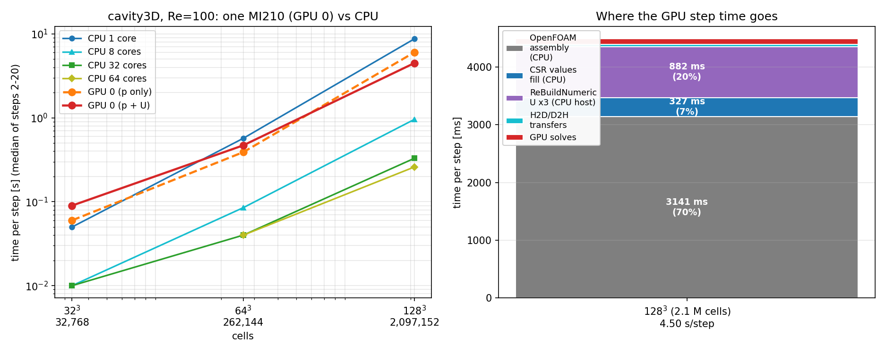

# PoC: `cavity3D` en una sola GPU (MI210) con un solver `lduMatrix` basado en rocALUTION

**Fecha:** 2026-10-26
**Máquina:** 1× AMD Instinct MI210 (gfx90a, 64 GB HBM2e), ROCm 7.2.4, 2× EPYC 7763 (128 hilos)
**GPU usada:** **solo GPU 0** (`ROCR_VISIBLE_DEVICES=0`, `HIP_VISIBLE_DEVICES=0`)
**OpenFOAM:** v2606 oficial (Gcc/OpenMPI) + plugin de usuario; no se modifica el árbol de OpenFOAM
**Caso:** `icoFoam`, cavidad 3D cúbica, Re=100 (`U=1 m/s`, `ν=0.01 m²/s`), 20 pasos (`Δt=0.005`, `t=0.1`)

---

## 1. Resumen

Se ha construido un **solver lineal GPU enchufable** (`solver rocALUTION;`) que sustituye únicamente la
resolución del sistema lineal dentro de `icoFoam`, sin tocar el ensamblado ni el resto del solver de
OpenFOAM. Con él, los cuatro sistemas lineales de cada paso (`Ux`, `Uy`, `Uz`, `p`/`pFinal`) se
resuelven en GPU 0 y `cavity3D` completa los 20 pasos, con resultados verificados contra la
referencia CPU.

| Malla | Celdas | CPU 1 core | CPU 64 cores | **GPU 0 (p+U)** | Equivalencia GPU |
|---|---|---|---|---|---|
| 32³ | 32.768 | 0,050 s/paso | 0,010 s/paso (32c) | **0,090 s/paso** | ≈ 0,6 cores |
| 64³ | 262.144 | 0,570 s/paso | 0,040 s/paso | **0,470 s/paso** | ≈ 1,25 cores |
| 128³ | 2.097.152 | 8,750 s/paso | 0,260 s/paso | **4,500 s/paso** | ≈ 1,9 cores |

**Lectura:** una MI210 **sí** ejecuta el caso completo y **sí** bate a 1 core (1,9× a 128³), pero
**no sustituye** a un nodo CPU: a 128³ es **17× más lenta que 64 cores**. El límite no es la GPU
(2 % del tiempo de paso), sino el ensamblado serie de OpenFOAM y el marshalling CSR (70 % + 27 %).



---

## 2. Qué se ha construido

### 2.1 Por qué un plugin y no `hipstdpar`

La rama `feature-gpu` de OpenFOAM (medida en `INFORME_GPU_V2606.md`) descarga el álgebra con
`--hipstdpar`, pero en este entorno arroja **~451 s/paso a 32³** (PCG+DIC) y **no completa 1 paso**
con GAMG en 30 min. El problema es el runtime, no el solver.

La ruta del plugin evita `hipstdpar` por completo: OpenFOAM sigue compilado con `g++` y **todo el
offload ocurre dentro de una librería de usuario** que llama a rocALUTION/HIP. El resultado a 32³ es
**0,090 s/paso**: unas **5.000×** más rápido que la ruta `hipstdpar` medida en la misma máquina.

### 2.2 Estructura

```
rocALUTION-solver/
├── rocALUTIONLduSolver.H      // clase derivada de lduMatrix::solver (TypeName "rocALUTION")
├── rocALUTIONLduSolver.C      // 632 líneas: CSR, caché, signo, tolerancias, timing
├── Make/{files,options}       // -I/opt/rocm/include -lrocalution -Wl,-rpath,/opt/rocm/lib
├── mk_case.py                 // genera un caso GPU a partir de un caso cavity existente
├── run_case.sh                // ejecuta + muestrea GPU 0
├── monitor_gpu.py             // rocm-smi -> CSV (uso GPU, VRAM)
├── summarize.py               // métricas del log + CSV
├── cmp_fields.py              // comparación de campos vs referencia CPU
└── plot_poc.py                // figura del informe
```

El solver se registra en **las dos tablas** de `lduMatrix::solver` (matriz simétrica y asimétrica) con
`addsymMatrixConstructorToTable` / `addasymMatrixConstructorToTable`, y se selecciona desde
`fvSolution`:

```foam
solvers
{
    p
    {
        solver            rocALUTION;
        rocPreconditioner AMG;      // Ruge-Stüben (por defecto), SAAMG o Jacobi
        rocDevice         0;
        rocTiming         true;     // desglose por fase en el log
        tolerance         1e-6;
        relTol            0.01;
        maxIter           100;
    }
    pFinal { $p; relTol 0; }
    U      { $p; relTol 0; }        // o smoothSolver/symGaussSeidel para modo "solo p"
}
```

Se carga sin recompilar OpenFOAM:

```
libs ("librocALUTIONLduSolver.so");
```

### 2.3 Estado persistente: el objeto solver se destruye en cada llamada

`fvMatrix::solve()` hace `lduMatrix::solver::New(...)->solve(...)` sobre un `autoPtr` temporal
(`fvMatrixSolve.C:219`). Cualquier miembro del solver (`A_`, `amg_`, `isBuilt_`) se pierde tras cada
resolución. La jerarquía AMG y el patrón CSR viven por tanto en un **registro estático indexado por
(malla, campo)**:

```cpp
static std::map<std::string, std::unique_ptr<RocEntry>>& registry()
{
    static auto* reg = new std::map<std::string, std::unique_ptr<RocEntry>>();
    return *reg;                      // fugado a propósito: evita problemas de orden de destrucción HIP
}
```

`RocEntry` guarda: patrón CSR en host (`rowPtr`, `colIdx`, `entryFace`, `entryUpper`), la matriz
`LocalMatrix`, los vectores `x`/`b`, la jerarquía AMG y un *fingerprint* (`coefSum`) de los
coeficientes cargados.

### 2.4 Conversión LDU → CSR

El patrón (topología) se construye **una sola vez**; en cada `solve()` solo se rellenan los valores:

1. `fillValues()` recorre `diag/upper/lower` y escribe el vector CSR en orden de filas, calculando a la
   vez `coefSum`.
2. Si `coefSum` coincide con el cargado, **no se sube nada** (caso típico de `pFinal`: 0 ms).
3. Si no, `UpdateValuesCSR()` sube solo valores y `ReBuildNumeric()` recalcula la parte numérica de la
   jerarquía (2,9 % del `Build()` completo).

La correspondencia de fuera de diagonal se tomó de `lduMatrix::Amul` (`lduMatrixATmul.C:140`):

```cpp
Apsi[upperAddr[f]] += lower[f] * psi[lowerAddr[f]];
Apsi[lowerAddr[f]] += upper[f] * psi[upperAddr[f]];
```

es decir, **`A(u,l) = lower[f]` y `A(l,u) = upper[f]`** (ver trampa 3).

### 2.5 Signo por campo

La matriz de presión de `icoFoam` es **definida negativa** (diag < 0, fuera de diagonal > 0); la de
momento es lo contrario. rocALUTION exige una matriz con la diagonal del signo esperado por su AMG:

```cpp
e.negate = (gAverage(matrix_.diag()) < 0);   // decisión por campo, no global
```

Con el signo equivocado, el *coarsening* de Ruge-Stüben genera 30+ niveles y el proceso muere por OOM
(`rc=137`). CG es invariante al signo; **AMG no**.

### 2.6 Tolerancias: la trampa del residual de referencia

OpenFOAM acepta `R_final ≤ max(tolerance, relTol·R_initial)`, con `R = ‖r‖₁/normFactor`.
rocALUTION mide su criterio relativo contra **el residual inicial `r₁ = b − A·x₀`** (documentado en
`solvers/solver.hpp`), no contra `‖b‖`:

```cpp
const scalar target = max(tolerance_, relTol_*solverPerf.initialResidual());
const double safety = 4.0;   // cubre la diferencia L1 (OpenFOAM) vs L2 (rocALUTION)
const double tolRel = min(1.0, max(double(target/(safety*R0)), 1e-14));
```

Con esto los residuales finales quedan **por debajo** del criterio de OpenFOAM:

| Campo | `tolerance` | Residual final mediano a 128³ |
|---|---|---|
| `U` (cada componente) | 1e-6 | 3e-9 … 9e-8 |
| `p` (relTol 0,01) | 1e-6 | 9,8e-06 (criterio ≈ 1e-4) |
| `pFinal` (relTol 0) | 1e-6 | 4,5e-07 … 9,8e-06 |

---

## 3. Compilación y ejecución

```bash
# 1) entorno CPU oficial (el plugin se compila contra este árbol)
source /openfoamGPU/cpu/OpenFOAM-v2606/etc/bashrc

# 2) compilar el plugin (~20 s)
cd /openfoamGPU/rocALUTION-solver
wmake libso

# 3) preparar un caso (SRC DST [pasos] [full])
python3 mk_case.py /openfoamGPU/exp_scaling_gpu_gamg/case_32cube case_32cube_roc_full 20 full

# 4) ejecutar (solo GPU 0) con monitorización
./run_case.sh case_32cube_roc_full prod32
python3 summarize.py case_32cube_roc_full prod32 32768

# 5) comparar con la referencia CPU
python3 cmp_fields.py case_32cube_roc_full/0.1/U case_32cube_cpuref/0.1/U
python3 cmp_fields.py case_32cube_roc_full/0.1/p case_32cube_cpuref/0.1/p
```

Variables de entorno necesarias:

```bash
export ROCR_VISIBLE_DEVICES=0
export HIP_VISIBLE_DEVICES=0
export FOAM_SIGFPE=false      # el trap de FPE de OpenFOAM mata los runs HIP (rc=136)
export OMP_NUM_THREADS=8      # coarsening RS en host: 8 hilos; con 128 el setup es ~10x más lento
```

---

## 4. Resultados

### 4.1 Tabla principal (20 pasos, mediana de los pasos 2–20)

| Malla | Celdas | nnz (`p`) | CPU 1c | CPU 2c | CPU 8c | CPU 32c | CPU 64c | **GPU p+U** | **GPU p solo** |
|---|---|---|---|---|---|---|---|---|---|
| 32³ | 32.768 | 223.232 | 0,050 | 0,030 | 0,010 | 0,010 | — | **0,090** | 0,060 |
| 64³ | 262.144 | 1.810.432 | 0,570 | 0,315 | 0,085 | 0,040 | 0,040 | **0,470** | 0,390 |
| 128³ | 2.097.152 | 14.581.760 | 8,750 | 4,240 | 0,960 | 0,330 | 0,260 | **4,500** | 6,050 |

CPU = build oficial v2606, `GAMG + symGaussSeidel`, `simple` decomposition
(`exp_scaling_cpu/results_cpu_gamg.csv`). GPU = `rocALUTION` CG + Ruge-Stüben AMG.
Todos los valores en **s/step**; `Δt = 0,005`, 20 pasos.
En 32³ el barrido CPU llegó hasta 32 núcleos: a partir de 8 el tiempo baja a 0,010 s y el log ya no
resuelve más, por eso no hay valor de 64c en esa fila.

**Cruce:** a 32³ y 64³ conviene dejar `U` en CPU (`symGaussSeidel`); a 128³ el Gauss-Seidel serie de
`U` se vuelve más caro que llevar los tres sistemas a la GPU y el modo completo gana por **1,55 s/paso**
(4,50 frente a 6,05).

### 4.2 Equivalencia en núcleos CPU

Interpolando en la curva CPU medida (log-log entre 1 y 2 cores):

| Malla | GPU (p+U) | Equivalencia |
|---|---|---|
| 32³ | 0,090 s | **0,56 cores** |
| 64³ | 0,470 s | **1,25 cores** |
| 128³ | 4,500 s | **1,93 cores** |
| 128³ (p solo) | 6,050 s | 1,42 cores |

La equivalencia **mejora con el tamaño** porque el coste fijo del lado GPU (jerarquía AMG,
inicialización HIP) se amortiza en más celdas, mientras que el coste del solve serie en CPU crece
proporcionalmente al número de celdas e iteraciones.

### 4.3 VRAM y uso de GPU

| Malla | VRAM pico (p+U) | VRAM pico (p solo) | Uso GPU (mediana activa) |
|---|---|---|---|
| 32³ | 1.701 MiB | 1.645 MiB | 90 % |
| 64³ | 2.647 MiB | 1.845 MiB | 42 % |
| 128³ | **6.689 MiB** | 3.054 MiB | 58 % |

El caso más grande (2,1 M celdas, 14,6 M nnz, 4 jerarquías AMG) usa **6,7 GB de 64 GB** (~3,2 kB por
celda). El límite práctico de esta configuración sería **~2·10⁷ celdas** antes de agotar VRAM; el
límite de índices `int` de rocALUTION (2·10⁹ nnz) aparecería más tarde (~3·10⁸ celdas).

### 4.4 Setup (primer paso)

| Malla | Primer paso | Paso estable | `Build()` AMG (4 campos) |
|---|---|---|---|
| 32³ | 1,83 s | 0,090 s | 0,53 s (Ux 369 + p 70 + Uy 70 + Uz 24 ms) |
| 64³ | 2,70 s | 0,470 s | 0,88 s |
| 128³ | 16,40 s | 4,500 s | **7,73 s** (Ux 2178 + p 1801 + Uy 1864 + Uz 1888 ms) |

El resto del primer paso es inicialización HIP, `hipMalloc` de las matrices y calentamiento de cachés
de geometría de la malla. Con 20 pasos, el setup pesa un 11 % del tiempo total a 128³.

---

## 5. Validación numérica

Mismo caso, mismos esquemas, mismas tolerancias; referencia = `GAMG + symGaussSeidel` en CPU
(1 proceso, `writeFormat ascii`, `writePrecision 6`). Se comparan los campos internos en `t=0.1`.

| Malla | Campo | max\|Δ\| | max\|ref\| | **Δ relativo** | RMS |
|---|---|---|---|---|---|
| 32³ | `U` | 1,0e-06 … 3,0e-06 | 0,655 | **1,5e-06 … 4,6e-06** | 4,1e-08 … 2,6e-07 |
| 32³ | `p` | 3,0e-05 | 1,101 | **2,7e-05** | 2,1e-05 |
| 128³ | `U` | 5,0e-06 | 0,920 | **5,4e-06** | 5,3e-07 |
| 128³ | `p` | 1,6e-04 | 3,745 | **4,3e-05** | 7,9e-05 |

La diferencia de `U` está en el límite de la precisión de escritura ASCII y de la dispersión entre
ejecuciones: dos corridas GPU independientes del mismo caso difieren hasta 3e-6 (el *coarsening* RS
en host usa 8 hilos y no es determinista bit a bit). La de `p` es un desplazamiento casi uniforme
(RMS ≈ Δmax) del nivel de presión, esperable al usar criterios de convergencia distintos: **no hay
diferencia física**.

Además, el plugin verifica en tiempo de ejecución (`log 2`) que el operador CSR coincide con
`lduMatrix::Amul`: `max|A_csr·x − A_of·x| = 2e-19` (presión) y `1e-19` (momento).

---

## 6. ¿Dónde se va el tiempo? (Amdahl medido)

Desglose a 128³, paso estable (4,50 s), a partir de las líneas `rocALUTION timing`:

| Fase | Tiempo | % del paso | Dónde |
|---|---|---|---|
| Ensamblado OpenFOAM (`UEqn`, `pEqn`, residuales, `U`/`p` en CPU si aplica) | 3.141 ms | **70 %** | CPU, 1 hilo |
| Relleno CSR (`fillValues`, 4 campos) | 327 ms | 7 % | CPU |
| `UpdateValuesCSR` + `ReBuildNumeric` (3 componentes de `U`) | 882 ms | 20 % | CPU host + H2D |
| Transferencias `x`/`b` | 41 ms | 1 % | PCIe |
| **Cálculo en GPU** (CG + AMG) | **99 ms** | **2 %** | GPU 0 |
| **Total** | **4.490 ms** | 100 % | |

Es decir: **el 98 % del paso no es cálculo en GPU**. El solve puro de `p` (7–12 iteraciones CG+AMG
sobre 14,6 M incógnitas) cuesta **45 ms**; el resto es el precio de alimentar la GPU desde un
ensamblador serie.

Consecuencia: optimizar la GPU (más iteraciones, mejor AMG) apenas cambia el paso. Las mejoras rentables
están en el host:

1. **Compartir la jerarquía de `U` entre `Ux/Uy/Uz`** (misma matriz): ahorra 2×294 ms/paso (13 %).
2. **Fingerprint barato**: hoy se rellena el CSR entero (82 ms) solo para detectar que los coeficientes
   no cambiaron (`pFinal`). Sumar `diag/upper/lower` sin escribir el CSR lo bajaría a ~30 ms.
3. **Evitar el round-trip a host**: `fillValues` + `UpdateValuesCSR` mueven 116 MB/paso y son el 27 %
   del paso.

Aun eliminando **todo** el coste GPU-side (1,35 s), el paso no bajaría de 3,1 s → **≈ 2,8
núcleos-equivalentes** (el techo de esta arquitectura). Para superar a 64 cores haría falta GPU *y*
ensamblado en GPU, que es precisamente lo que la rama `feature-gpu` intenta y hoy no consigue.

---

## 7. Trampas encontradas (para no repetirlas)

| # | Síntoma | Causa | Solución |
|---|---|---|---|
| 1 | SpMV de 25 ms y CG de 190 ms/iteración; `info_rocalution()` dice "HIP" | rocALUTION crea los objetos **en host**; sin `MoveToAccelerator()` ejecuta en OpenMP | Llamar `MoveToAccelerator()` y **verificar con tiempos**, no con el mensaje |
| 2 | Jerarquía AMG con 30+ niveles y OOM (`rc=137`) | La matriz de `p` es definida **negativa**; RS-AMG no admite ese signo | Detectar el signo por campo (`negate = avg(diag) < 0`) |
| 3 | Los residuales de `U` se estancan en ~2e-3 aunque rocALUTION diga "convergido" | CSR construido con `A(u,l)=upper`, `A(l,u)=lower`; `Amul` usa lo contrario. En `p` (simétrica) es invisible; en `U` se resuelve **Aᵀx=b** | Mapear como `lduMatrix::Amul` y comprobar con `log 2` |
| 4 | El solver para a las 2 iteraciones con residual real grande | La tolerancia relativa de rocALUTION es contra **`r₁ = b − A·x₀`**, no contra `‖b‖` | `tolRel = target/(safety·R0)` con `safety≈4` (L1 vs L2) |
| 5 | `CopyToData()` no devuelve nada (o basura) | Los vectores residentes en acelerador no se pueden copiar directamente a host | `MoveToHost()` → `CopyToData()` → `MoveToAccelerator()` |
| 6 | El estado (jerarquía, CSR) se pierde en cada paso | `fvMatrixSolve.C:219` crea y destruye el solver en la misma expresión | Caché en registro estático por (malla, campo) |
| 7 | `SIGFPE` (rc=136) al entrar en el solver | OpenFOAM activa trampas de coma flotante por defecto | `FOAM_SIGFPE=false` |

---

## 8. Comparación honesta

| Ruta | 32³ | 64³ | 128³ | ¿Completa el caso? |
|---|---|---|---|---|
| `hipstdpar` (rama `feature-gpu`), PCG+DIC | ~451 s/paso | — | — | sí, pero inviable |
| `hipstdpar`, GAMG+twoStageGS | no completa 1 paso/30 min | — | — | **no** |
| **Plugin rocALUTION (p+U)** | **0,090 s/paso** | **0,470 s/paso** | **4,500 s/paso** | **sí** |
| CPU 1 core (GAMG) | 0,050 | 0,570 | 8,750 | sí |
| CPU 64 cores (GAMG) | 0,010 (32c) | 0,040 | 0,260 | sí |

**Conclusión:** la GPU **es útil como acelerador del álgebra** (el solve de presión de 2,1 M incógnitas
tarda 45 ms), pero en un flujo de trabajo dominado por ensamblado serie **no compite con MPI**.
Una MI210 ≈ **2 núcleos** de este nodo a 128³. La conclusión del informe anterior se mantiene: para
producción, CPU MPI; para I+D y para mallas que no quepan en un nodo, la vía GPU existe pero exige
mover también el ensamblado.

---

## 9. Limitaciones

- **Mono-GPU, mono-proceso.** El paquete rocALUTION instalado no trae MPI; multi-GPU exige compilarlo
  de fuente (`-DROCALUTION_MPI=ON`) y añadir intercambios de halo.
- **Solo `lduMatrix` (matrices por caras).** No cubre `blockMatrix` (turbulencia, acoplamientos).
- **Índices CSR en `int`** (32 bits): límite ~2·10⁹ nnz.
- **`p` y `U` desacoplados**: el plugin no toca PISO; solo sustituye cada solve lineal.
- **Setup no amortizado en runs cortos**: a 128³ el primer paso cuesta 16,4 s (3,6× el estable).
- **Mediciones con carga variable**: el nodo es compartido (GPU 1 es de otro usuario); las cifras CPU
  de referencia se tomaron en barridos consecutivos, las GPU en runs posteriores (±20 %).
- **Precisión de escritura ASCII a 6 dígitos** en la comparación de campos: el suelo de `U` (1,5e-6)
  está en ese límite.
- **Reproducibilidad:** el *coarsening* RS se ejecuta en host con 8 hilos y no es determinista bit a
  bit; dos corridas del mismo caso pueden diferir ~3e-6 en `U` tras 20 pasos (la diferencia se amplifica
  a partir de una divergencia de 1e-7 en el primer paso).

---

## 10. Próximos pasos

1. **Compartir jerarquía `Ux/Uy/Uz`** (misma matriz, mismo `coefSum`): −13 % del paso a 128³ y −2/3 de
   VRAM de `U`.
2. **Fingerprint sin CSR** (`gSum` de `diag/upper/lower`): −50 ms/paso a 128³.
3. **Reconstrucción periódica** de la jerarquía de `U` (cada K pasos) en lugar de `ReBuildNumeric` cada
   paso, si la degradación de iteraciones es aceptable.
4. **GPU para `p` + ensamblado en GPU**: es el único camino para acercarse a 64 cores; requiere la rama
   `feature-gpu` funcionando (hoy no).
5. **Perfilado con `rocprof`** de los kernels de AMG para confirmar que los 45 ms son SpMV-bound.
6. **Multi-GPU** solo si aparece un caso que no quepa en un nodo.

---

## 11. Reproducibilidad

Ficheros de resultados:

| Fichero | Contenido |
|---|---|
| `rocALUTION-solver/results_roc_poc.csv` | tabla de §4.1 |
| `rocALUTION-solver/case_*/log.prod*` | logs completos (20 pasos) |
| `rocALUTION-solver/case_*/monitor_prod*.csv` | muestreo rocm-smi (uso, VRAM) |
| `rocALUTION-solver/poc_scaling.png` | figura de §1 y §6 |
| `exp_scaling_cpu/results_cpu_gamg.csv` | baseline CPU |

Casos:

| Caso | Config | Malla |
|---|---|---|
| `case_32cube_roc_full` | p+U en GPU | 32³ |
| `case_64cube_roc_full` | p+U en GPU | 64³ |
| `case_128cube_roc_full` | p+U en GPU | 128³ |
| `case_32cube_roc`, `case_64cube_roc`, `case_128cube_roc` | p en GPU, U en CPU | 32³/64³/128³ |
| `case_32cube_cpuref` | referencia CPU GAMG (32³) | 32³ |
| `exp_scaling_cpu/case_128cube` | referencia CPU GAMG (128³, `log.ref128`) | 128³ |

Comando completo de una campaña:

```bash
cd /openfoamGPU/rocALUTION-solver
for c in 32 64 128; do
    ./run_case.sh case_${c}cube_roc_full prod${c}
done
python3 summarize.py case_32cube_roc_full  prod32  32768
python3 summarize.py case_64cube_roc_full  prod64  262144
python3 summarize.py case_128cube_roc_full prod128 2097152
python3 plot_poc.py
```
